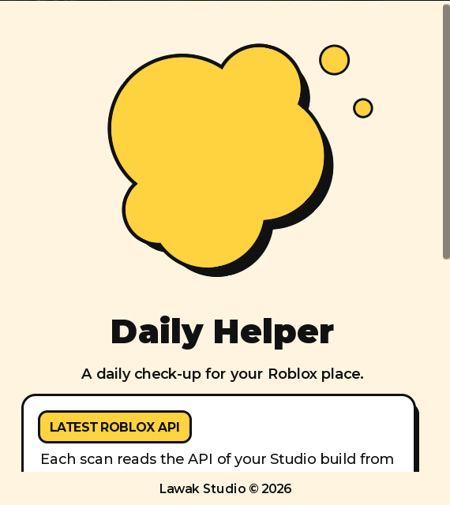
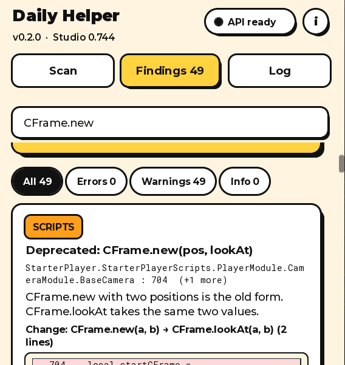
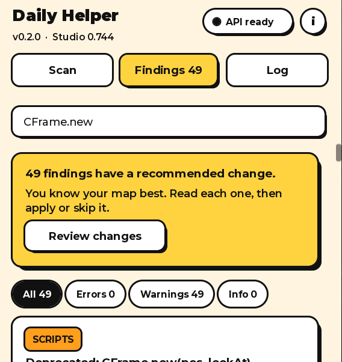
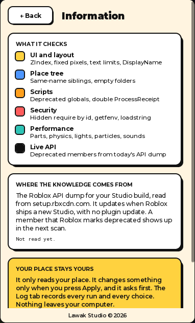

<p align="center">
  
</p>

<h1 align="center">Daily Helper</h1>

<p align="center">
  A daily check-up for your Roblox place. A Roblox Studio plugin by Lawak Studio.
</p>

<p align="center">
  <a href="https://github.com/FattahWG/Plugin-roblox-Daily-Helper/releases/latest"><b>Download the latest release</b></a>
  ·
  <a href="CHANGELOG.md">Changelog</a>
  ·
  <a href="docs/CHECKS.md">All rules</a>
</p>

<p align="center">
  
  
</p>

Daily Helper scans the open place in a few seconds. It finds old API names, common script bugs, risky
code, UI traps and heavy parts of the map. For each finding, it explains the problem in plain words.
When a safe fix exists, it shows the exact change and asks before it applies it.

> **Beta (v0.2.0).** Daily Helper is in beta and gets regular updates. Each update has a release with
> notes on the [Releases](https://github.com/FattahWG/Plugin-roblox-Daily-Helper/releases) page. The scan
> only reads your place. The automatic script fixes are new, so read the before and after lines of each
> fix before you press Apply. Found a false alarm or a bug? Open an
> [issue](https://github.com/FattahWG/Plugin-roblox-Daily-Helper/issues).

## Contents

- [Features](#features)
- [Install](#install)
- [Use](#use)
- [Your place stays yours](#your-place-stays-yours)
- [How it works](#how-it-works)
- [Build from source](#build-from-source)
- [Limits](#limits)
- [Changelog](CHANGELOG.md)

## Features

| Check | What it finds |
|---|---|
| **UI and layout** | A ScreenGui with `Global` ZIndex, a script that makes a ScreenGui and never sets its ZIndex, scaled text with no size limit, big windows with a fixed pixel size, a username shown where a DisplayName belongs |
| **Place tree** | Same-name siblings that break `FindFirstChild` and `WaitForChild`, empty folders that no script names |
| **Scripts** | A name used above its `local` line, `wait()`, `delay()` and `spawn()`, old CFrame and Vector3 names (`.p`, `.lookVector`, `.magnitude`, `:inverse()`, `CFrame.new(pos, lookAt)`), more than one `ProcessReceipt` |
| **Security** | `require(<asset id>)`, `getfenv` and `setfenv`, `loadstring`, hidden escaped text, Discord webhook addresses |
| **Performance** | Part count, unanchored assemblies, lights with shadows, fast particle emitters, looping sounds, unions with precise collision |
| **Live API** | Members and classes that the Roblox API of **your current Studio build** marks as deprecated |

The full list of rules, with what each rule skips, is in [docs/CHECKS.md](docs/CHECKS.md).

**Always current.** At each scan, Daily Helper reads the Roblox API dump for your Studio version from
`setup.rbxcdn.com`. When Roblox ships a new Studio, the next scan knows the new deprecations. The
plugin itself needs no update for this.

<p align="center">
  
  
</p>

## Install

1. Download **[DailyHelper.rbxm](https://github.com/FattahWG/Plugin-roblox-Daily-Helper/releases/latest/download/DailyHelper.rbxm)**
   from the latest release. The XML copy
   [DailyHelper.rbxmx](https://github.com/FattahWG/Plugin-roblox-Daily-Helper/releases/latest/download/DailyHelper.rbxmx)
   is the same plugin. The [`dist/`](dist/) folder holds the same files.
2. Put the file in your local Plugins folder:
   - Windows: `%LOCALAPPDATA%\Roblox\Plugins`
   - macOS: `~/Documents/Roblox/Plugins`
3. Restart Roblox Studio.
4. On the **Plugins** tab, click **Daily Helper**.

You can also open the folder from Studio: **Plugins** tab, then **Plugins Folder**.

**Update:** download the new release and replace the old file in the Plugins folder, then restart
Studio. Your settings, text size and logs stay.

## Use

1. Click **Daily Helper**. The start screen opens.
2. Under **Text size**, pick the value that matches your Windows display scale (100%, 125%, 150% or
   175%). Studio does not scale plugin windows, so this setting does it. The plugin remembers it.
3. Click **Start**, choose **Whole place** or **Selection**, and click **Run Audit**.
4. After the scan, a prompt lists the changes that the plugin can make. Risky changes start unticked.
   Pick the ones that fit your map, or click **Not now**.
5. On the **Findings** tab, use the search bar and the filters. For each finding:
   - **Open** opens the script at the line. **Select** selects the objects.
   - **Apply** makes the change. **Skip** and **Mark reviewed** record your choice.
   - **Restore** puts back the script text from before an Apply.
6. The **Log** tab records each scan, apply, skip, restore and undo. **Copy** shows the log as text
   that you can select.

## Your place stays yours

- The scan only reads. It changes nothing.
- Nothing changes until you press **Apply**, and the plugin asks first.
- Each script fix shows its before and after lines. The preview and the real edit use the same code.
- Before each edit, the plugin checks that the line still holds the text from the scan. If you changed
  the line, the edit stops and changes nothing.
- Each property change is one undo step (Ctrl+Z).
- Daily Helper keeps the script text from before each Apply. **Restore** puts it back. Restore refuses
  if you changed the script after Apply, so it never writes over your work.
- The log and the settings stay in the plugin settings on your computer. Nothing goes into your place.
- The only web request is the download of the public Roblox API dump. No data about your place leaves
  your computer.

## How it works

```
src/
  init.server.luau   Toolbar button and dock window. Starts App.
  App.luau           State and actions: scan, apply, skip, restore, search, text size.
  View.luau          The UI: start screen, Information, Scan, Findings, Log, prompts.
  Theme.luau         Colors and fonts (Neo-Brutalism: cream, black, one yellow).
  Scanner.luau       Collects instances and scripts, runs the checks, merges copies, scores.
  Lexer.luau         Blanks comments and strings, and keeps every line and column.
  Edit.luau          Script fixes as compute(source) functions: apply, preview and restore.
  ApiDump.luau       Reads the Roblox API dump and caches the deprecated names.
  Log.luau           The Log tab store, per place, in the plugin settings.
  Checks/            One module per check, plus DataTypes and DeclareOrder rules.
build.py             Packs src/ into dist/DailyHelper.rbxmx and installs it.
```

- **No `loadstring`, no `getfenv`, no `require(<id>)`.** The plugin source is plain and readable.
- **Comments and strings are blanked first.** A rule never matches text inside a comment or a string.
- **The same code in many scripts gives one finding.** For example, a rig script copied into 17 models
  gives one card, and one Apply fixes all 17 copies.
- **Smooth animation.** The blob on the start screen moves by rotation, not by position, so Roblox does
  not snap it to whole pixels.

## Build from source

Requirements: Python 3.

```
python build.py              # writes dist/DailyHelper.rbxmx and copies it to the Plugins folder
python build.py --no-install # writes dist/DailyHelper.rbxmx only
```

Restart Studio after a build. Studio loads a local plugin only when it starts.

## Limits

Daily Helper is a fast daily check. It is not a full code review.

- It cannot read Studio's own Script Analysis messages, because Roblox has no API for them.
- It does not know the type of a value. Rules that depend on a type test the text around the name
  instead, and they skip unclear cases.
- The declaration rule checks top-level `local` lines only. Inner blocks are not checked.
- It finds no logic bugs, such as missing server checks, race conditions or data loss. These need a
  person who reads the code.
- It does not run the game. Memory leaks and frame rate need a playtest.

## License

Copyright © 2026 Lawak Studio. All rights reserved.
